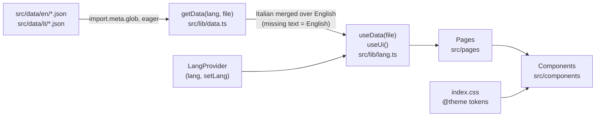

# Architecture

*Owner: Team C. Update whenever the structure changes. Checked against the code of the repository.*

How to install and run the project is in the [README](../README.md). The technology choices are in [TECH_SPEC.md](TECH_SPEC.md) and the content files are in [DATA_SCHEMA.md](DATA_SCHEMA.md).

## Overview

The site is a client-side single-page app. There is no server code and no network request for content: all JSON files in `src/data` are imported at build time and end up in the JavaScript bundle. React Router maps the URL to a page component, the page reads its content with a hook, and shared components render it.

## Approved sitemap

| ID | Page | Route |
|---|---|---|
| S-01 | Home | `/` |
| S-02 | Research / Projects | `/projects` |
| S-03 | People | `/people` |
| S-04 | News / Events | `/news` |
| S-05 | About | `/about` |
| S-06 | Contact | `/contact` |
| S-07 | Project detail | `/projects/:id` |
| S-08 | News / event detail | `/news/:id` |
| S-09 | Networking | `/networking` |

## Project structure

```text
project-root/
├── .github/
│   ├── ISSUE_TEMPLATE/       Bug report and task templates
│   ├── workflows/            check.yml, pages.yml
│   └── pull_request_template.md
├── docs/                     Project documentation
├── public/
│   ├── files/                Downloadable files (Regulations.pdf)
│   ├── images/placeholders/  image-16x9.svg, photo-4x5.svg
│   ├── favicon.svg
│   └── icons.svg
├── src/
│   ├── components/           Shared UI components and their tests
│   ├── pages/                One file per route and its tests
│   ├── data/
│   │   ├── en/               English JSON content
│   │   └── it/               Italian JSON content
│   ├── lib/                  Data loading, language, filters, formatting, types, UI strings, tests
│   ├── App.tsx               Route table, header and footer
│   ├── main.tsx              Entry point and providers
│   ├── index.css             Tailwind import and @theme design tokens
│   └── vite-env.d.ts
├── index.html
├── vite.config.ts            Vite, React, Tailwind plugin and Vitest (jsdom)
├── tsconfig*.json
├── .oxlintrc.json, .prettierrc, .nvmrc
└── package.json
```

There is no `src/networking`, `src/styles`, `public/icons` or `public/fonts` folder. The Networking page is `src/pages/Networking.tsx`, its content is `networking.json`, and the font package is installed from npm (`@fontsource/inter`, see [open items](TECH_SPEC.md#known-limitations-and-open-items)).

## Folders and responsibilities

| Folder | What lives here | Who mostly works here |
|---|---|---|
| `src/components` | Reusable UI components. Names match the Component_Inventory. | B |
| `src/pages` | Route-level page components, one file per page. | B, with A for content |
| `src/data/en`, `src/data/it` | JSON content, one folder per language, same file names and ids. | A |
| `src/lib` | Data loader, language context, filter rules, formatting helpers, base folder helper, types, interface strings. | B, reviewed by C |
| `src/index.css` | Tailwind import and `@theme` design tokens. | B |
| `public` | Static files served as they are: images, the PDF, favicon, icon sprite. | B |
| `docs`, `.github` | Documentation, templates and CI. | C |

## Application shell

`src/main.tsx` renders the providers in this order:

```text
StrictMode > LangProvider > BrowserRouter > App
```

`App.tsx` renders `HeaderNav` with the `Routes` as its children, followed by `Footer`. The header, the footer and the language are therefore the same on every page.

## Data flow



1. **Loading.** `data.ts` imports every `src/data/<lang>/<file>.json` at build time. The eight file names are listed in `FILE_NAMES`; their types are in `src/lib/types.ts` (`DataFiles` maps each file name to its type).
2. **Language and fallback.** `getData(lang, file)` returns the English file for `en`. For `it` it merges the Italian file over the English one with `mergeWithFallback`: where Italian has no value (missing, `null` or an empty string) the English value is used. The structure of the English file decides what exists: lists follow the English order and length, items with an `id` are matched by id, and items that exist only in Italian are ignored. A missing Italian file shows English (with a console warning in development). A missing English file throws an error. Results are cached per language and file.
3. **Hooks.** `useData('news')` returns the file for the current language. `useUi()` returns the interface strings of `src/lib/ui.ts` (labels such as "Read more", "Back to projects", result counts) that do not belong to a content file. Both hooks read the language from `LangProvider`.
4. **Pages.** A page reads its data and passes it to shared components. Small selectors live in `data.ts`: `getNewestNews`, `getNewestProjects` (used by the Home page and the header dropdowns) and `getNewsYears` (the year filter).
5. **Language state.** `LangProvider` keeps the language, saves it in `localStorage` under the key `lang`, falls back to English if nothing valid is saved or storage is blocked, and sets `<html lang>`.

## Routing

`App.tsx` declares the routes with React Router (`BrowserRouter`, URLs without `#`). The route table is in the [README](../README.md#routes).

- An unknown path matches `*` and shows the 404 page.
- `/projects/:id` and `/news/:id` look the item up in the current language's data. An unknown id renders the 404 content on the same URL.
- **Anchors.** Links such as `/about#regulations` or `/networking#visiting-scholars` target an `anchor` value defined in the page's JSON. The router does not scroll to a hash on in-app navigation, so the About and Networking pages scroll to the element themselves (`scrollIntoView`, smooth). The Contact page's "join us" button scrolls to the form the same way.
- The internal-links test reads the routes from `App.tsx` with a regular expression. Declare every route as `<Route path="..." element={...} />` so the test can find it.

## Pages

| Page (file) | Route | Data used |
|---|---|---|
| `Home.tsx` | `/` | `home`, newest items of `news` |
| `About.tsx` | `/about` | `about` |
| `People.tsx` | `/people` | `people`, `site.groups` |
| `Networking.tsx` | `/networking` | `networking` |
| `Projects.tsx` | `/projects` | `projects`, `site.filters.status` |
| `ProjectDetail.tsx` | `/projects/:id` | `projects`, `people`, `site.filters` |
| `News.tsx` | `/news` | `news`, `site.filters` |
| `NewsDetail.tsx` | `/news/:id` | `news` |
| `Contact.tsx` | `/contact` | `contact` |
| `NotFound.tsx` | `*` | `site.notFound` |

## Components

| Component | Purpose |
|---|---|
| `HeaderNav` (K-01) | Sticky header: logo, five menu entries with dropdowns, search icon, IT \| EN switch, phone menu. Dropdown items come from `site.nav`; the Projects and News dropdowns show the newest items plus "View all". Closes on navigation, on Escape and on a click outside. |
| `Footer` | Description, contact details, quick links, social links. All text from `site.footer`. |
| `Card` (K-04) | One component with seven variants: `feature`, `news-event`, `project` (with `featured`), `person`, `member`, `partner`, `scholar`. |
| `HeroBanner` (K-05) | Hero of the Home page. |
| `Filter` (K-06) | One filter as `pills` or `dropdown`. The matching rules are in `src/lib/filters.ts`. |
| `MissionSection`, `SectionTitle`, `DetailsPanel`, `BackLink`, `Label`, `ArrowIcon` | Building blocks of pages and cards. |
| `Button` | Primary, secondary, outline and text variants. Renders a router link (`to`), an external link (`href`, opens in a new tab) or a button. |
| `FormField` | Text, email, textarea and checkbox fields with label, error and success message. |

## Styling and design tokens

Styling uses Tailwind utility classes in the JSX. Colours, type sizes, spacing, radius, focus ring, layout width and breakpoints are `@theme static` variables in `src/index.css` (T04, frozen on Day 5; owner: Team B). A test (`design-tokens.test.ts`) fails if a component contains a hand-written colour (hex, `rgb()` or a Tailwind palette colour such as `gray-500`) or refers to a `--color-*` variable that `index.css` does not declare.

## Tests

Tests run with Vitest in jsdom and React Testing Library. Component and page tests sit next to the file they test; cross-cutting tests sit in `src/lib`.

| Area | Where | What it protects |
|---|---|---|
| Data structure | `lib/data.test.ts` | Every file exists in both languages, Italian has the same structure as English, the English fallback works. |
| Data integrity | `lib/data-integrity.test.ts` | Same ids in both languages, unique ids, fixed value lists (D-18), ISO dates, every image exists in `public/`, no template text left (D-22). |
| Internal links | `lib/internal-links.test.ts` | Every internal link reaches a route and every `#anchor` exists on the target page. |
| Anchors | `lib/anchors.test.tsx`, `anchors.test.tsx` | Dropdown items scroll to their section in both languages. |
| Design tokens | `lib/design-tokens.test.ts` | Colours come from the tokens (see above). |
| Language | `lib/LangProvider.test.tsx` | Default language, switching menu and footer, saved language restored, invalid saved value ignored. |
| Filters | `lib/filters.test.ts`, `lib/news-filters.test.tsx` | The matching rules, and the `Filter` component wired like the News page, on the real data. The `News.tsx` page itself has no test of its own. |
| Components | `components/*.test.tsx` | Header, footer, card, filter, form field, section title. |
| Pages | `pages/*.test.tsx` | Home, About, People and Projects, Project detail, Networking, News detail, Contact (including validation) and 404 render their content and behave as specified. |

## Continuous integration

- `check.yml` runs `npm ci` and `npm run check` on Node 24 for every pull request and every push to `main`.
- `pages.yml` publishes the site on GitHub Pages when started by hand (see "Publishing on GitHub Pages" below).

### Publishing on GitHub Pages

The site is a static build, so it can be published on GitHub Pages. A project page lives in a sub-folder (`https://<owner>.github.io/<repository-name>/`), which has three consequences, all handled in the code:

- **Base folder.** `vite.config.ts` reads the variable `VITE_BASE` (default `/`). The workflow sets it to `/<repository-name>/`, and `main.tsx` gives the same folder to the router (`basename`).
- **Files of `public/`.** The data files keep plain paths such as `/images/placeholders/photo-4x5.svg`. `src/lib/base.ts` (`prefixAssets`, called in `getData`) adds the base folder in front of the paths that start with `/images/`, `/files/`, `/icons/` or `/fonts/`. Routes (`/projects`) are not changed, the router does that.
- **Reloading a page.** GitHub Pages shows `404.html` for an address it does not know. The workflow copies `index.html` to `404.html`, so a reload on `/projects/proj-001` opens the app.

To test it on your computer (PowerShell, one line at a time):

```bash
$env:VITE_BASE="/my-repo/"
npm run build
npm run preview
```

Open the address shown by `npm run preview` and add `/my-repo/`. The workflow `.github/workflows/pages.yml` is started by hand (Actions, Deploy to GitHub Pages, Run workflow) after Settings, Pages, Source: GitHub Actions. If you add a file to a data path, keep it in `public/images`, `public/files`, `public/icons` or `public/fonts`.

## Adding a page

1. Add the page component to `src/pages` (function component, named export).
2. Add `<Route path="..." element={...} />` to `src/App.tsx`.
3. If the page has its own content, add `src/data/en/<name>.json` and `src/data/it/<name>.json`, add the type to `DataFiles` in `src/lib/types.ts` and the name to `FILE_NAMES` in `src/lib/data.ts`. List pages follow the structure `{title, intro, emptyState, items}` (D-24).
4. Add the page to the menu in `site.json` (both languages) and to the footer quick links if needed.
5. Reuse components from `src/components` where possible.
6. Add a page test, and run `npm run check`.
7. Update the sitemap and routes tables in this document, in the README and in `TECH_SPEC.md`.

## Adding a language

The language list is not only data. Besides a new `src/data/<code>/` folder with all eight files, change:

- the `Lang` type in `src/lib/types.ts` and `LANGS` in `src/lib/data.ts`;
- the `ui` object in `src/lib/ui.ts` (typed as `Record<Lang, ...>`, so the compiler lists what is missing);
- `languageSwitch.options` in `site.json`;
- the two places in `src/lib/format.ts` that choose the date and number locale (`it-IT` for Italian, `en-GB` otherwise).

## Architecture rules

- Keep shared UI in `src/components`, route-level pages in `src/pages`, utilities in `src/lib`.
- Keep all page content in `src/data/en` and `src/data/it`. Do not hard-code texts in components. Interface labels that are not content go in `src/lib/ui.ts` for every language.
- Keep design tokens and global styles in `src/index.css`. Use token colours, never hand-written ones.
- Keep static files in `public`. Image paths in the data start with `/images/`.
- Do not create duplicate or parallel folder structures, and do not reference `src/styles`.
- Run `npm run check` before every pull request.
- When the structure or the routes change, update this document, the README and `TECH_SPEC.md`.
